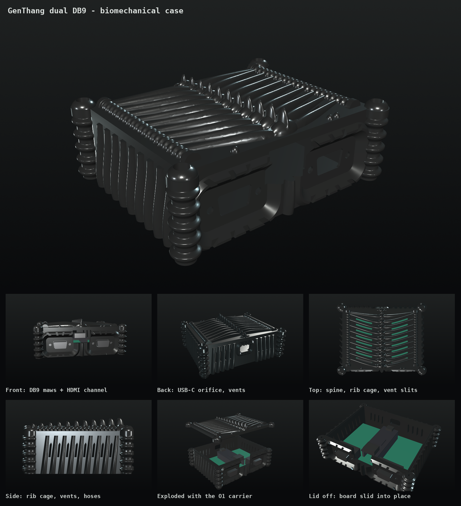

# GenThang dual DB9: biomechanical case (Giger-inspired)

A 3D-printable two-part enclosure for the two-player carrier
[O1, dual-db9-opt-pcb](../dual-db9-opt-pcb/README.md) with its Tang Nano 20K, in the style of
H. R. Giger's biomechanical art: a spine and rib cage on the lid, the ribs continuing down the
walls, vertebral-disc corner columns, corrugated hoses, and the two controller ports as toothed
maws. All geometry is original and parametric (CadQuery). It borrows the style, not any artwork.

The case has been printed. Every dimension comes from the
drawings in [../dual-db9-opt-pcb/reference](../dual-db9-opt-pcb/reference) and the generator
constants in [build_board.py](../dual-db9-opt-pcb/build_board.py).



## Print

| Part | File | Orientation | Size (mm) | Volume |
|---|---|---|---|---:|
| Base | [stl/case_base.stl](stl/case_base.stl) | floor on the bed, as exported | 121.7 × 98.4 × 35.3 | 73.6 cm³ |
| Lid | [stl/case_lid.stl](stl/case_lid.stl) | flat underside on the bed, as exported | 121.0 × 97.7 × 15.0 | 44.8 cm³ |

- **No supports.** All of the lid relief is built from upper half-solids standing on the plate, so it has no
  undercuts. On the base, the column discs, rib flanks, vent tops, bezel flanks and DB9 funnels are all
  45° or steeper. The only bridges are short:
  the DB9 shell openings (17.9 mm), the USB-C opening (11–15 mm), the lid groove (1.9 mm) and the
  optional foot recesses (10.6 mm). `check_print.py` lists them and confirms both meshes are closed
  2-manifolds.
- PLA or PETG, 0.2 mm layers, 3 walls, 15–20 % infill. Black filament, optionally dry-brushed with
  silver, gives the airbrushed-chrome look.
- Assembled: 121.7 × 98.4 × 48.5 mm.

## Hardware

| Qty | Part | Where |
|---:|---|---|
| 4 | M2.5 × 6 mm self-tapping screw | board to the floor bosses (2.1 mm pilots, 6 mm deep) |
| 4 | M3 × 12 mm screw (head ≤ 6.2 mm) | lid to the corner columns (2.5 mm pilots, 15 mm deep) |
| 4 | *optional* #4-40 × 3/16 in screw | through the port wall into the DB9 threaded inserts; only if your plugs clear the heads |
| 4 | *optional* 10 mm round bump-on foot | recesses under the floor |

## Assembly

1. Put the TF card in the Nano first: the slot is on its underside, so you can only reach it with
   the Nano out of its sockets. ROM upload over USB (`genthang-upload`) works with the case closed
   only with a `GT_SERIAL_UPLOAD=1` firmware build; it is disabled in the standard build.
2. Plug the Nano into the carrier with USB-C at the back (away from the DB9s).
3. Lower the board into the base with its back edge against the back wall. The cavity is 6.9 mm longer than the
   board for this. Then **slide it forward**: the DB9 shells pass through the D-shaped openings until
   the flanges stop against the 1.2 mm port wall.
4. Screw the board to the four bosses (M2.5).
5. Seat the lid (its groove locates on the rim tongue) and screw it down (M3) through the four
   knuckles over the corner columns.

Player 1 is the left port seen from the front (one node above it on the lid), player 2 the right
(two nodes). HDMI leaves through the channel between the maws, USB-C (power and ROM upload)
through the orifice at the back. Side and back vents plus the slits between the lid ribs ventilate
the Nano. The menu is opened from the pad (Select+Start / Mode+Start), so the Nano's buttons and
LEDs are not exposed.

## Fit check

`build_case.py` builds envelopes of the PCB, both Kycon K22X-E9P-N connectors (flange, body, shell,
boardlocks and tails), the Harwin sockets with the Nano's header bodies, the Nano with its HDMI and
USB-C receptacles, mated plugs and the lid screws, and fails unless every overlap is zero. It also
moves the populated board along the whole slide-in travel and checks it drops straight into the back of
the cavity. A planted collision (board 1 mm forward or plug 0.5 mm deeper) is reported, so a zero
result means the parts really clear. Results: [fit-report.json](fit-report.json).

| Key height above the bed | mm |
|---|---:|
| PCB top | 9.0 |
| DB9 centre line | 15.3 |
| Nano top face | 21.6 |
| HDMI / USB-C centre | 24.8 / 23.3 |
| Lid underside (base rim) | 33.5 |

## Assumptions and limits

- **Controller plug** face at most 32 × 16 mm, seated in the 35 × 19 mm recess. The 1.2 mm port wall
  leaves 4.9 mm of the 6.1 mm DB9 shell for mating. If your Sega pad's plug is bigger, increase
  `DB9_POCKET` (and check `PORT_WALL`).
- **HDMI plug** at most 24 mm wide and about 15 mm tall. The Nano's HDMI port is 10 mm behind the board
  edge, and the plug reaches it through the open channel.
- **USB-C plug**: overmold at most 13 × 7.5 mm and at least 15 mm long. The receptacle sits 14.7 mm
  inside the back wall.
- The Nano stack height uses the documented 11.04 mm socket + header stack-up; the HDMI and USB-C
  receptacle heights are nominal.
- See [O1's limits](../dual-db9-opt-pcb/README.md#limits).

## Files and rebuild

- [build_case.py](build_case.py): parametric model, STL/STEP export and fit check
  (CadQuery 2.x). Writes `stl/`, `mockup/` (component envelopes, reference only),
  [dual-db9-biomech-case.step](dual-db9-biomech-case.step) and `fit-report.json`.
- [check_print.py](check_print.py): mesh closure and overhang/bridge report (numpy).
- [render_case.py](render_case.py): offscreen VTK renders and the contact sheet in `renders/`.

```sh
python3 build_case.py      # about 2 minutes
python3 check_print.py
python3 render_case.py
```
