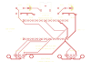
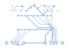

# Two-player Genesis carrier with line-out — L3

**Start building:** the [illustrated L3 assembly guide](index.html) includes a
simple capacitor chooser, soldering steps, pre-power checks and firmware downloads.

**[O1](../dual-db9-opt-pcb/README.md) plus a stereo 3.5 mm line-out**, all through-hole for easy
DIY soldering. Same Nano socket parts, the same two DB9 ports and the same canonical
`GT_PAD=db9` pinout as O1, so player wiring and controllers are unchanged. The line-out
works in both HDMI and DVI modes, so a TV that flickers with HDMI data islands can run
in **Video output: DVI+LINE OUT** and get sound from powered speakers.

L3 keeps L2's Tang orientation on its top-mounted female headers: **USB-C power
left, HDMI right, audio at the rear, DB9 ports at the front**. No separate power
connector is added; the existing Tang USB-C port remains the power input.

**L3 changes only the right-audio connection:** GPIO17 at **J6 contact 15** now
feeds R2, instead of GPIO56 at J5 contact 7. Both DB9 player pinouts, left audio,
filter parts, dimensions and connector locations are unchanged. The Tang plugs
directly into L3 with no audio jumper; J5 contact 7 is unconnected on this carrier.
GPIO17 is unused by the controller ports but has the Nano's on-board LED2 load
(510 Ω to the LED supply). No LED modification is required for the selected pin
test; this revision does not guarantee noise-free audio.

## Reorder from OSH Park

Upload **[dual-db9-lineout-L3-OSHPARK.zip](dual-db9-lineout-L3-OSHPARK.zip)** to
[OSH Park](https://oshpark.com/) using its standard
[two-layer, 1 oz, 1.6 mm service](https://docs.oshpark.com/services/two-layer/).
Do not reorder from an L1/L2 ZIP. This package contains only the two copper,
two mask, two silkscreen, outline, plated-drill and non-plated-drill files.
Confirm the preview shows **100 × 70 mm**, two copper layers, the rear jack notch
and **three 0.60 × 1.40 mm plated jack slots** before paying. Check the L3
marking on the silkscreen. The author confirms successful testing of the GPIO17
right-audio move and has submitted L3 to OSH Park. See the
[test status](TEST-STATUS.md) for the scope of that confirmation; this remains a
prototype fabrication package, not a production qualification.

Verify the files with `sha256sum -c SHA256SUMS` from this directory. The
[validation report](validation.json) covers the firmware pin contract,
schematic/PCB equivalence, connector clearance, drill and annular-ring limits,
and DRC. Same board outline and mount/connector positions as L2, so its cases
remain mechanically compatible.




## Parts (every part is through-hole)

| Ref | Qty | Part | Notes |
|---|---:|---|---|
| J5, J6 | 2 | Harwin M20-7822046, 1×20 female socket, 2.54 mm, 8.5 mm tall | any similar 1×20 female header fits |
| J1, J2 | 2 | Kycon K22X-E9P-N, right-angle male DB9 | other DB9 parts are not fit-checked |
| J3 | 1 | CUI / Same Sky SJ1-3523N, 3.5 mm stereo jack, right angle | footprint is for this part |
| R1, R2 | 2 | 1 kΩ, ¼ W axial, 7.62 mm (0.3 in) pitch | |
| R3, R4 | 2 | 47 kΩ, ¼ W axial, 7.62 mm pitch | 22k–100k is fine |
| C1, C2 | 2 | 10 nF (code 103) ceramic disc or film, 5.0 mm pitch | |
| C3, C4 | 2 | 10 µF 16 V+ radial electrolytic, 5 mm dia, 2.0 mm pitch | **polarized** |

Full list with descriptions: [BOM.csv](BOM.csv).

## Line-out circuit (one per channel)

```
Nano pin ──R1/R2 1k──┬──C3/C4 10µF (+ toward R)──┬──► jack tip (L) / ring (R)
                     │                           │
                  C1/C2 10nF                 R3/R4 47k
                     │                           │
GND ─────────────────┴───────────────────────────┴──► jack sleeve
```

| Channel | FPGA pin | Nano contact | Jack |
|---|---|---|---|
| Left | GPIO31 (`audio_jack_l`) | J6.14 | tip, J3 pin 2 |
| Right | GPIO17 (`audio_jack_r`) | J6.15 | ring, J3 pin 3 |
| Ground | GND | J6.20 / J5.15 | sleeve, J3 pin 1 |

The 1 kΩ and 10 nF turn GenThang's 1-bit audio into an analog signal (≈16 kHz
corner). The 10 µF blocks the 1.65 V DC level. R3/R4 are extra compared with the
README breadboard filter: they keep the output side of the capacitor at 0 V so plugging
in a speaker does not give a loud pop. Output is about 1 V peak to peak: **powered
speakers, a soundbar or an amplifier, not headphones**.

### Optional Model 1-style low-pass filter

For a darker, original Genesis Model 1-style frequency response, replace **only C1
and C2**, one per channel. Keep R1/R2 at 1 kΩ:

| Filter option | C1 and C2 | Capacitor marking | Nominal cutoff |
|---|---|---|---|
| Stock L3 | 10 nF | `103` | 15.9 kHz |
| Model 1 VA0–VA2-style | 47 nF | `473` | 3.39 kHz |
| Model 1 VA3–VA6-style | 56 nF | `563` | 2.84 kHz |

**Simple choice:** start with two **10 nF (`103`)** capacitors for the stock
response. Choose **47 nF (`473`)** for a darker VA0–VA2-style response, or
**56 nF (`563`)** for a darker VA3–VA6-style response.
For the 56 nF option, use two film capacitors, 5% tolerance, 50 V,
5.0 mm lead spacing. These are nonpolarized; either direction works. Check the
chosen capacitor's body dimensions against the board and enclosure before buying.
Use the same value in both channels. Power off and unplug USB before replacing parts.

Leave R3/R4 at 47 kΩ and C3/C4 at 10 µF. The electrolytics remain polarized, with
their positive leads toward R1/R2, not the jack. No PCB trace or firmware changes
are required. The BOM, schematic and fabrication files retain the stock 10 nF value;
these substitutions are optional assembly variants.

The nominal corners use `fc = 1 / (2 * pi * R * C)`. R3/R4 and the connected
amplifier input load the filter, shifting the actual corner and output level; use a
high-impedance line input. These values approximate the analog low-pass cutoff,
not the complete sound of an original console's DAC, mixer and amplifier, or any
filtering already applied in firmware. This optional response has not been
hardware-measured on L3.

The revision-specific targets (3.39 kHz for VA0–VA2 and 2.84 kHz for VA3–VA6) are
described in [Genesis & Sega CD - Audio Filtering](https://jsgroth.dev/blog/posts/genesis-sega-cd-audio-filtering/#in-genesis-hardware).
This recommendation does not cover the different Model 1 VA7 audio circuit.

## Controller connections

Unchanged from O1; see its [connection table](../dual-db9-opt-pcb/README.md#connections-from-the-genthang-constraints-file).
Player 1 is entirely on J6 and player 2 entirely on J5. Pin 5 of each DB9 is 3.3 V.

## Firmware

Use a DB9 build with **`audio_jack_l` on GPIO31 and `audio_jack_r` on GPIO17**.
This is already on [GenThang main](https://github.com/shawnchivers/genthang/commit/fbf6664c5f6448510bc2a2ebbf7aaf82cb94554c).
Download the [packaged GPIO17 flash image](https://raw.githubusercontent.com/shawnchivers/genthang/main/builds/db9-gpio17/genthang_nano20k_db9_gpio17_flash.bin)
and its [checksums](https://raw.githubusercontent.com/shawnchivers/genthang/main/builds/db9-gpio17/SHA256SUMS).
Released images through 1.9.2 output right audio on GPIO56 and do not match L3.
The generator reads the pin assignments, including the two audio pins, from
`genthang/src/boards/nano20k_db9.cst`; a copy is in
[reference/built-pinout.cst](reference/built-pinout.cst), and the check fails if the
board, schematic and constraints disagree.
When this design is imported under GenThang's `hardware/` directory, the generator
reads that repository's `src/boards/nano20k_db9.cst` directly.

L1/L2 compatibility: with the Tang removed from the carrier, an isolated jumper
from **Tang J6.15 to PCB J5.7** can feed the old right filter from the new firmware.
Do not also connect Tang J5.7 (GPIO56) to that filter. Power off before rewiring.

## Files

- [Routed KiCad PCB](dual-db9-lineout-pcb.kicad_pcb), [schematic PDF](schematic.pdf)
- [Top copper](board-top.svg), [bottom copper](board-bottom.svg), [assembly top](assembly-top.svg),
  [1:1 fit print](fit-1to1.svg)
- [Gerbers + drills](fabrication/), [generic Gerber ZIP](dual-db9-lineout-L3-gerbers.zip),
  [OSH Park ZIP](dual-db9-lineout-L3-OSHPARK.zip)
- [BOM](BOM.csv), [assembly guide](ASSEMBLY.md), [continuity test list](net-test.csv),
  [DRC](drc.txt), [validation](validation.json), [checksums](SHA256SUMS)
- [Illustrated build guide](index.html), [author-reported test status](TEST-STATUS.md)

## Mechanics

- 100×70 mm, 2 layers, 1.6 mm FR-4, 1 oz. Same DB9 positions and M2.5 mounting holes
  as O1; the Nano socket positions and audio edge differ.
- The Tang is mounted on 8.5 mm female headers, with its 54.04×22.55 mm envelope
  horizontal. J5 is the rear row, J6 the front row; both pin-1 pads are at the left
  (USB-C) end. The 20.32 mm row spacing and canonical pin numbering are unchanged.
- USB-C and HDMI cables plug in above the rectangular carrier. The full-width
  corridors to both module ends are free of other parts and mounting-hole envelopes;
  they are marked on the assembly drawing and fit print. Actual cable-shell height
  and enclosure fit still need a physical check with the selected headers and cables.
- J3 sits at the rear/top edge, x = 50 mm; its barrel overhangs the edge by 2 mm and the
  outline has the small notch the KiCad footprint specifies under the barrel. The jack
  has three **0.60×1.40 mm plated slots**, widened from L1's unsupported 0.40 mm
  width to exceed OSH Park's 0.508 mm minimum. Slot length is unchanged and copper
  annular rings exceed the 0.127 mm minimum.
- The filter parts sit behind J5, on either side of the jack, clear of the Nano and
  both cable corridors. DB9 front-row escape tracks are hand-routed before autorouting.
- Power/ground 0.60 mm, signals 0.30 mm, clearance 0.25 mm, 0.8/0.4 mm vias.

## Status and limits

KiCad DRC: 0 violations, 0 unconnected pads. The firmware pin contract, the line-out
circuit contract and schematic/PCB equivalence pass. The author has confirmed that
moving right audio to GPIO17 works and has submitted L3 to OSH Park.
See [TEST-STATUS.md](TEST-STATUS.md) for the distinction between this bench
confirmation and the generated CAD report.
Slot width, drill size, annular rings, and module/cable corridor placement are checked
explicitly in addition to DRC. L3 supersedes the L1/L2 fabrication ZIPs for GPIO17 firmware.
Same limits as O1: no ESD protection or buffering, 3.3 V pads only, no controller hot
plug. Keep the Nano's speaker and LCD connectors empty.

## Reproduce

Via `bash ../cad-python`: `build_board.py generate`, `route` (Freerouting), `import`
(also runs the checks and native DRC), `export`. Regression tests:
`bash ../cad-python -m unittest discover -s . -p 'test_build_board.py'`.

After documentation-only edits, refresh the release manifest without recreating
the already-ordered Gerbers:
`bash ../cad-python build_board.py checksums`. The manifest includes the illustrated
guide, its SVG assets and the test-status note.
